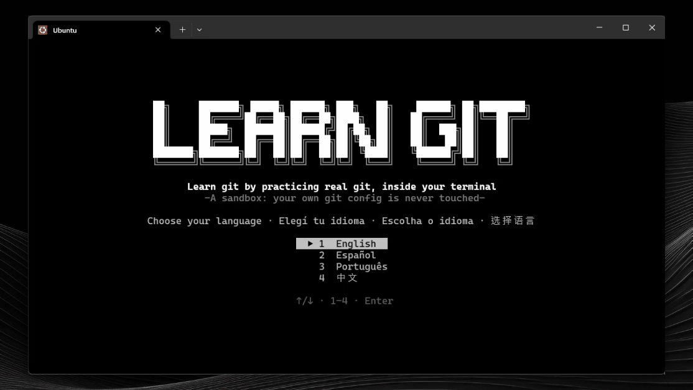
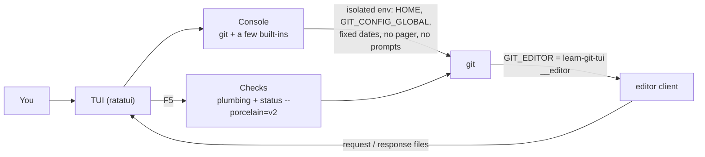

<div align="center">

**English** · [Español](docs/readme/README_es.md) · [Português (Brasil)](docs/readme/README_pt-BR.md) · [简体中文](docs/readme/README_zh.md)

# learn-git-tui

### Learn git by practicing real git, inside your terminal.

**11 levels, 156 lessons and 153 hands-on exercises, in English, Spanish, Portuguese and Chinese. Every command runs on a real git inside an isolated sandbox that never touches your own configuration.**

[](#install)
[](#requirements)
[](#requirements)
[](#languages)

[Showcase](#showcase) · [Quick start](#quick-start) · [How it works](#how-it-works) · [Levels](#levels) · [Controls](#controls) · [FAQ](#faq) · [Development](#development)

</div>

> [!NOTE]
> You practice with the real `git`, but your own setup is safe: the app uses its own `HOME`, its own global config and fixed dates. Your `~/.gitconfig` and your credentials are never read or changed.

---

Each exercise gives you a small situation ("a commit broke production", "a teammate pushed first") and a console. You solve it however you like; pressing `F5` inspects the **state of the repository**, not the commands you typed, so every correct path counts. If a check fails, the app explains what is missing and puts the sandbox back at the start of the exercise.

## Showcase

<p align="center"></p>

## Quick start

### Requirements

- **git 2.34 or newer** in your `PATH`.
- Optional. When something is missing, that lesson turns into a plain explanation:
  - `ssh-keygen`: signed commits and tags (SSH signatures).
  - `git subtree`: the subtree lesson (some distributions do not ship it).
  - git 2.38 or newer: `git diagnose` and `git merge-tree --write-tree`.
- To build from source: Rust stable with the 2024 edition (1.85 or newer).

### Install

Download the binary for your system from the [Releases](https://github.com/matiasdante/learn-git-in-a-tui/releases) page:

| System | File |
| --- | --- |
| Windows x86_64 | `learn-git-tui-windows-x86_64.exe` |
| Linux x86_64 (static) | `learn-git-tui-linux-x86_64` |

Or build it with cargo (this is also the way to get it on macOS):

```sh
cargo install --git https://github.com/matiasdante/learn-git-in-a-tui
```

### Run

```sh
learn-git-tui
learn-git-tui --version
```

On the first launch you pick a language and can take a 10-question placement exam (two questions for each of levels 1 to 5). A perfect score starts you at level 6; skipping it starts you at level 1. Earlier levels are always open.

## How it works



- **Console.** It runs `git` plus `ls`, `cat`, `cd`, `pwd`, `mkdir`, `touch`, `rm`, `chmod +x`, `echo > / >>`, `edit` and `clear`, with `<`, `>` and `>>` redirections for git. No shell is involved, so it behaves the same on Windows and Linux. `git -C`, `--git-dir` and `--work-tree` are accepted only when they point inside the sandbox.
- **Editor.** Git opens the built-in editor for `commit` without `-m`, `rebase -i`, `mergetool`, `bugreport`... The editor is this same executable with a hidden `__editor` subcommand that talks to the TUI through files in the sandbox.
- **Checks.** They read the repository with plumbing and machine formats (`rev-parse`, `for-each-ref`, `status --porcelain=v2`, `cat-file`), never the human-oriented output that changes between git versions.
- **Real git.** Hashes are stable because the author and committer dates are fixed.

## Levels

| # | Level | Lessons | Exercises |
| --- | --- | --- | --- |
| 1 | Fundamentals | 13 | 18 |
| 2 | Branches and tags | 10 | 21 |
| 3 | Remotes (local bare repositories, no network) | 7 | 14 |
| 4 | Undo and rewrite | 9 | 16 |
| 5 | Investigating history | 10 | 10 |
| 6 | Patches and the e-mail workflow | 12 | 8 |
| 7 | Large and multiple repositories | 8 | 8 |
| 8 | Configuration, security and automation | 16 | 15 |
| 9 | Plumbing: objects and refs | 35 | 25 |
| 10 | Storage and maintenance | 18 | 18 |
| 11 | Servers and protocols (explanations only) | 18 | 0 |

Internal commands and servers are explained without an exercise; obsolete commands are not included. `git maintenance start` and `register` are explained but never run, because they would change the scheduler of your real computer.

## Languages

English, Spanish (`es`), Portuguese (`pt`) and Chinese (`zh`). Press `L` in the menus to switch; the choice is saved. All texts live in `content/i18n/<language>/` and a test fails if any text is missing in any language.

## Controls

| Key | Action |
| --- | --- |
| `↑` `↓` · `Enter` · `Esc` | move, open, go back |
| `L` | change language (menus) |
| `F1` | show the next hint (−25 points) |
| `F5` | check the exercise (each failed check costs 10 points) |
| `F6` | next exercise |
| `Ctrl+R` | restart the exercise (in free mode: reset the sandbox) |
| `Ctrl+D` | close the stdin of the running command (`credential approve`, `mktree`...) |
| `Ctrl+C` | stop the running command, or clear the line |
| `Ctrl+S` · `Esc` | in the editor: save and close · cancel |
| `Ctrl+Q` | quit |

An exercise is worth 100 points, never less than 25. There is also a **free mode** with a sandbox of your own, and 33 **achievements**.

## Where it stores data

Everything lives in the `learn-git-tui` folder inside your user data directory (`~/.local/share` on Linux, `%APPDATA%` on Windows):

| Path | Content |
| --- | --- |
| `progress.json` | language, finished exercises, points, achievements |
| `sandbox/` | the practice repository, its own `HOME` and its own `gitconfig` |

Delete `progress.json` to start from scratch.

## FAQ

<details>
<summary><strong>Does it touch my real git configuration?</strong></summary>

No. Every git process starts with an empty environment plus `HOME` and `GIT_CONFIG_GLOBAL` pointing into the sandbox, `GIT_CONFIG_NOSYSTEM=1`, `GIT_TERMINAL_PROMPT=0` and fixed dates. A test checks that `git config --global` inside the app leaves your real `~/.gitconfig` untouched.

</details>

<details>
<summary><strong>Do I have to type exactly the commands the lesson suggests?</strong></summary>

No. The checks look at the resulting state of the repository, so any correct way works. Some topics leave no state (`git help`, `git --version`); for those the app looks at what you typed.

</details>

<details>
<summary><strong>A lesson shows "explanation only". Why?</strong></summary>

Either the topic has no exercise (internals, servers) or your machine lacks something the exercise needs: `ssh-keygen`, `git subtree` or git 2.38+. The message names what is missing.

</details>

<details>
<summary><strong>Does it need a network?</strong></summary>

No. Remotes are bare repositories in folders such as `server.git`, and the `file://` transport is allowed inside the sandbox.

</details>

## Development

```sh
cargo test                                   # unit, integration and content tests
cargo clippy --all-targets -- -D warnings
cargo fmt --check
```

The content test walks every exercise: the untouched starting state must fail its checks and the reference solution must pass them. It also requires every text in every language. CI runs everything on Ubuntu and Windows.

Lessons are TOML files in `content/level*/`, embedded in the binary. A lesson file holds only the structure (`setup` actions, number of hints, declarative `checks`, a reference `solution`); the texts are in `content/i18n/{en,es,pt,zh}/` under keys such as `init-1.prompt`, `init-1.hint1` and `init-1.check1.fail`.

## Releases

A tag `v*` builds the Windows `.exe` and a static Linux (musl) binary and publishes both to Releases.

```sh
git tag -a v1.0.0 -m "v1.0.0"
git push origin v1.0.0
```

## Known limits

- Real remotes over a network, a macOS binary, mouse support, external merge tools, an auto-updater and ANSI colors are out of scope.
- The terminal needs about 100 columns for the long screens. The title banner needs at least 66 columns (and a tall window on the level map); otherwise it falls back to plain text.
- Chinese needs a terminal font with CJK glyphs.

## License

[MIT](LICENSE). Anyone can use, copy, modify and distribute this project, for free, as long as the copyright notice is kept: **© 2026 Matias Dante Sarco**, creator of learn-git-tui.
