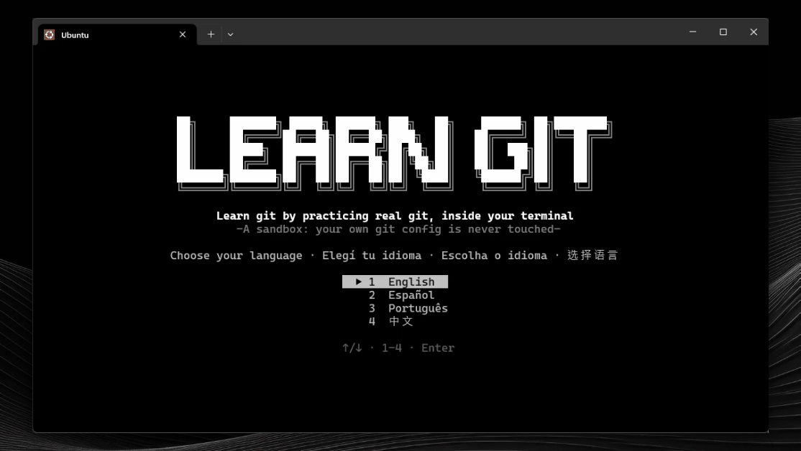
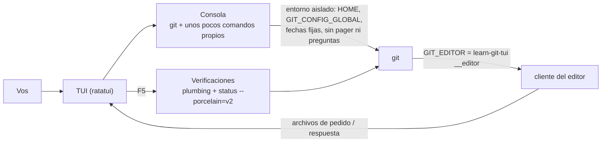

<div align="center">

[English](../../README.md) · **Español** · [Português (Brasil)](README_pt-BR.md) · [简体中文](README_zh.md)

# learn-git-tui

### Aprendé git practicando con git real, dentro de tu terminal.

**11 niveles, 156 lecciones y 153 ejercicios prácticos, en inglés, español, portugués y chino. Cada comando corre sobre un git real dentro de un sandbox aislado que nunca toca tu propia configuración.**

[](#instalación)
[](#requisitos)
[](#requisitos)
[](#idiomas)

[Demo](#demo) · [Inicio rápido](#inicio-rápido) · [Cómo funciona](#cómo-funciona) · [Niveles](#niveles) · [Controles](#controles) · [Preguntas frecuentes](#preguntas-frecuentes) · [Desarrollo](#desarrollo)

</div>

> [!NOTE]
> Practicás con el `git` de verdad, pero tu entorno está a salvo: la app usa su propio `HOME`, su propia configuración global y fechas fijas. Tu `~/.gitconfig` y tus credenciales nunca se leen ni se modifican.

---

Cada ejercicio te plantea una situación chica ("un commit rompió producción", "un compañero hizo push antes") y una consola. Lo resolvés como quieras; al apretar `F5` se revisa el **estado del repositorio**, no los comandos que tipeaste, así que vale cualquier camino correcto. Si una verificación falla, la app explica qué falta y deja el sandbox como estaba al inicio del ejercicio.

## Demo

<p align="center"></p>

## Inicio rápido

### Requisitos

- **git 2.34 o más nuevo** en el `PATH`.
- Opcionales. Si falta algo, esa lección pasa a ser solo una explicación:
  - `ssh-keygen`: commits y tags firmados con SSH.
  - `git subtree`: la lección de subtree (algunas distribuciones no lo incluyen).
  - git 2.38 o más nuevo: `git diagnose` y `git merge-tree --write-tree`.
- Para compilar: Rust estable con edición 2024 (1.85 o más nuevo).

### Instalación

Bajá el binario de tu sistema desde la página de [Releases](https://github.com/matiasdante/learn-git-in-a-tui/releases):

| Sistema | Archivo |
| --- | --- |
| Windows x86_64 | `learn-git-tui-windows-x86_64.exe` |
| Linux x86_64 (estático) | `learn-git-tui-linux-x86_64` |

O compilalo con cargo (también es la forma de usarlo en macOS):

```sh
cargo install --git https://github.com/matiasdante/learn-git-in-a-tui
```

### Ejecución

```sh
learn-git-tui
learn-git-tui --version
```

En el primer arranque elegís el idioma y podés rendir un examen de ubicación de 10 preguntas (dos por cada uno de los niveles 1 a 5). Con todo correcto arrancás en el nivel 6; si lo omitís, en el 1. Los niveles anteriores siempre están abiertos.

## Cómo funciona



- **Consola.** Ejecuta `git` más `ls`, `cat`, `cd`, `pwd`, `mkdir`, `touch`, `rm`, `chmod +x`, `echo > / >>`, `edit` y `clear`, con redirecciones `<`, `>` y `>>` para git. No hay ninguna shell de por medio, así que se comporta igual en Windows y Linux. `git -C`, `--git-dir` y `--work-tree` solo se aceptan si apuntan adentro del sandbox.
- **Editor.** Git abre el editor integrado para `commit` sin `-m`, `rebase -i`, `mergetool`, `bugreport`... El editor es este mismo ejecutable con un subcomando oculto `__editor` que habla con la interfaz mediante archivos del sandbox.
- **Verificaciones.** Leen el repositorio con plumbing y formatos de máquina (`rev-parse`, `for-each-ref`, `status --porcelain=v2`, `cat-file`), nunca la salida pensada para humanos, que cambia entre versiones de git.
- **Git real.** Los hashes son estables porque las fechas de autor y de committer están fijas.

## Niveles

| # | Nivel | Lecciones | Ejercicios |
| --- | --- | --- | --- |
| 1 | Fundamentos | 13 | 18 |
| 2 | Ramas y tags | 10 | 21 |
| 3 | Remotos (repositorios bare locales, sin red) | 7 | 14 |
| 4 | Deshacer y reescribir | 9 | 16 |
| 5 | Investigar la historia | 10 | 10 |
| 6 | Parches y flujo por mail | 12 | 8 |
| 7 | Repos grandes y múltiples | 8 | 8 |
| 8 | Configuración, seguridad y automatización | 16 | 15 |
| 9 | Plumbing: objetos y referencias | 35 | 25 |
| 10 | Almacenamiento y mantenimiento | 18 | 18 |
| 11 | Servidores y protocolos (solo explicaciones) | 18 | 0 |

Los temas internos y los servidores se explican sin ejercicio; los comandos obsoletos no se incluyen. `git maintenance start` y `register` se explican pero nunca se ejecutan, porque cambiarían el programador de tareas de tu computadora real.

## Idiomas

Inglés, español (`es`), portugués (`pt`) y chino (`zh`). Con `L` en los menús cambiás de idioma; la elección se guarda. Todos los textos viven en `content/i18n/<idioma>/` y un test falla si falta cualquier texto en cualquier idioma.

## Controles

| Tecla | Acción |
| --- | --- |
| `↑` `↓` · `Enter` · `Esc` | moverse, abrir, volver |
| `L` | cambiar de idioma (menús) |
| `F1` | mostrar la próxima pista (−25 puntos) |
| `F5` | verificar el ejercicio (cada verificación fallida cuesta 10 puntos) |
| `F6` | pasar al siguiente ejercicio |
| `Ctrl+R` | reiniciar el ejercicio (en modo libre: reiniciar el sandbox) |
| `Ctrl+D` | cerrar el stdin del comando en curso (`credential approve`, `mktree`...) |
| `Ctrl+C` | detener el comando en curso o limpiar la línea |
| `Ctrl+S` · `Esc` | en el editor: guardar y cerrar · cancelar |
| `Ctrl+Q` | salir |

Un ejercicio vale 100 puntos, nunca menos de 25. También hay un **modo libre** con un sandbox propio y 33 **logros**.

## Dónde guarda los datos

Todo está en la carpeta `learn-git-tui` dentro del directorio de datos del usuario (`~/.local/share` en Linux, `%APPDATA%` en Windows):

| Ruta | Contenido |
| --- | --- |
| `progress.json` | idioma, ejercicios hechos, puntos y logros |
| `sandbox/` | el repositorio de práctica, su propio `HOME` y su propio `gitconfig` |

Para empezar de cero, borrá `progress.json`.

## Preguntas frecuentes

<details>
<summary><strong>¿Toca mi configuración real de git?</strong></summary>

No. Cada proceso de git arranca con un entorno vacío más `HOME` y `GIT_CONFIG_GLOBAL` apuntando al sandbox, `GIT_CONFIG_NOSYSTEM=1`, `GIT_TERMINAL_PROMPT=0` y fechas fijas. Un test comprueba que `git config --global` dentro de la app deja intacto tu `~/.gitconfig` real.

</details>

<details>
<summary><strong>¿Tengo que tipear exactamente los comandos que sugiere la lección?</strong></summary>

No. Las verificaciones miran el estado resultante del repositorio, así que sirve cualquier camino correcto. Algunos temas no dejan estado (`git help`, `git --version`); para esos la app mira lo que tipeaste.

</details>

<details>
<summary><strong>Una lección dice "solo explicación". ¿Por qué?</strong></summary>

O el tema no tiene ejercicio (internos, servidores) o a tu máquina le falta algo que el ejercicio necesita: `ssh-keygen`, `git subtree` o git 2.38+. El mensaje nombra lo que falta.

</details>

<details>
<summary><strong>¿Necesita red?</strong></summary>

No. Los remotos son repositorios bare en carpetas como `server.git`, y el transporte `file://` está permitido dentro del sandbox.

</details>

## Desarrollo

```sh
cargo test
cargo clippy --all-targets -- -D warnings
cargo fmt --check
```

El test de contenido recorre cada ejercicio: el estado inicial sin tocar tiene que fallar los checks y la solución de referencia tiene que pasarlos. También exige todos los textos en todos los idiomas. El CI corre todo en Ubuntu y Windows.

Las lecciones son archivos TOML en `content/level*/`, embebidos en el binario. Un archivo de lección tiene solo la estructura (acciones de `setup`, cantidad de pistas, `checks` declarativos, una `solution` de referencia); los textos están en `content/i18n/{en,es,pt,zh}/` bajo claves como `init-1.prompt`, `init-1.hint1` y `init-1.check1.fail`.

## Releases

Un tag `v*` compila el `.exe` de Windows y un binario estático de Linux (musl) y publica los dos en Releases.

```sh
git tag -a v1.0.0 -m "v1.0.0"
git push origin v1.0.0
```

## Límites conocidos

- Fuera de alcance: remotos reales por red, un binario para macOS, mouse, herramientas de merge externas, actualizador automático y colores ANSI.
- La terminal necesita unas 100 columnas para las pantallas largas. El banner del título necesita al menos 66 columnas (y una ventana alta en el mapa de niveles); si no entra, se muestra texto simple.
- El chino necesita una tipografía de terminal con caracteres CJK.

## Licencia

[MIT](../../LICENSE). Cualquiera puede usar, copiar, modificar y distribuir este proyecto, gratis, siempre que conserve el aviso de copyright: **© 2026 Matias Dante Sarco**, creador de learn-git-tui.
