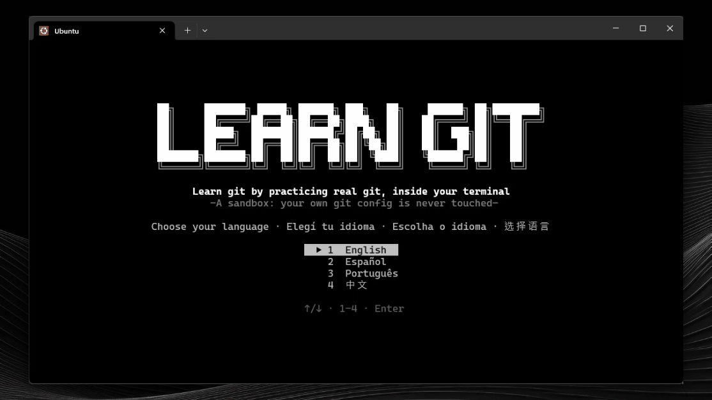
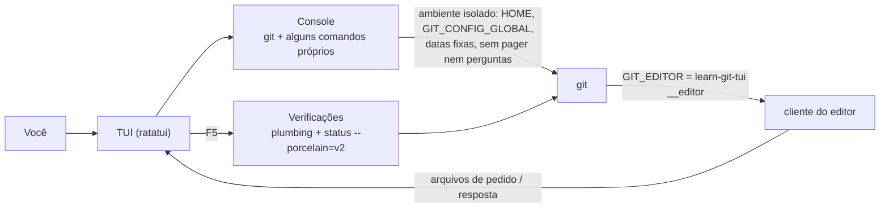

<div align="center">

[English](../../README.md) · [Español](README_es.md) · **Português (Brasil)** · [简体中文](README_zh.md)

# learn-git-tui

### Aprenda git praticando com git de verdade, dentro do seu terminal.

**11 níveis, 156 lições e 153 exercícios práticos, em inglês, espanhol, português e chinês. Cada comando roda em um git de verdade dentro de um sandbox isolado que nunca toca na sua própria configuração.**

[](#instalação)
[](#requisitos)
[](#requisitos)
[](#idiomas)

[Demonstração](#demonstração) · [Início rápido](#início-rápido) · [Como funciona](#como-funciona) · [Níveis](#níveis) · [Controles](#controles) · [Perguntas frequentes](#perguntas-frequentes) · [Desenvolvimento](#desenvolvimento)

</div>

> [!NOTE]
> Você pratica com o `git` de verdade, mas o seu ambiente fica seguro: o app usa seu próprio `HOME`, sua própria configuração global e datas fixas. Seu `~/.gitconfig` e suas credenciais nunca são lidos nem alterados.

---

Cada exercício apresenta uma situação pequena ("um commit quebrou a produção", "um colega fez push antes") e um console. Você resolve como quiser; ao apertar `F5` o app examina o **estado do repositório**, não os comandos que você digitou, então qualquer caminho correto vale. Se uma verificação falha, o app explica o que falta e devolve o sandbox ao estado do início do exercício.

## Demonstração

<p align="center"></p>

## Início rápido

### Requisitos

- **git 2.34 ou mais novo** no `PATH`.
- Opcionais. Se algo faltar, aquela lição vira apenas uma explicação:
  - `ssh-keygen`: commits e tags assinados com SSH.
  - `git subtree`: a lição de subtree (algumas distribuições não o incluem).
  - git 2.38 ou mais novo: `git diagnose` e `git merge-tree --write-tree`.
- Para compilar: Rust estável com a edição 2024 (1.85 ou mais novo).

### Instalação

Baixe o binário do seu sistema na página de [Releases](https://github.com/matiasdante/learn-git-in-a-tui/releases):

| Sistema | Arquivo |
| --- | --- |
| Windows x86_64 | `learn-git-tui-windows-x86_64.exe` |
| Linux x86_64 (estático) | `learn-git-tui-linux-x86_64` |

Ou compile com o cargo (também é a forma de usá-lo no macOS):

```sh
cargo install --git https://github.com/matiasdante/learn-git-in-a-tui
```

### Execução

```sh
learn-git-tui
learn-git-tui --version
```

Na primeira execução você escolhe o idioma e pode fazer um exame de nivelamento de 10 perguntas (duas para cada um dos níveis 1 a 5). Acertando tudo, você começa no nível 6; se pular o exame, começa no 1. Os níveis anteriores ficam sempre abertos.

## Como funciona



- **Console.** Executa `git` mais `ls`, `cat`, `cd`, `pwd`, `mkdir`, `touch`, `rm`, `chmod +x`, `echo > / >>`, `edit` e `clear`, com redirecionamentos `<`, `>` e `>>` para o git. Nenhum shell é usado, então o comportamento é o mesmo no Windows e no Linux. `git -C`, `--git-dir` e `--work-tree` só são aceitos se apontarem para dentro do sandbox.
- **Editor.** O git abre o editor embutido para `commit` sem `-m`, `rebase -i`, `mergetool`, `bugreport`... O editor é este mesmo executável com um subcomando oculto `__editor`, que conversa com a interface por arquivos do sandbox.
- **Verificações.** Leem o repositório com plumbing e formatos de máquina (`rev-parse`, `for-each-ref`, `status --porcelain=v2`, `cat-file`), nunca a saída feita para humanos, que muda entre versões do git.
- **Git de verdade.** Os hashes são estáveis porque as datas de autor e de committer são fixas.

## Níveis

| # | Nível | Lições | Exercícios |
| --- | --- | --- | --- |
| 1 | Fundamentos | 13 | 18 |
| 2 | Branches e tags | 10 | 21 |
| 3 | Remotos (repositórios bare locais, sem rede) | 7 | 14 |
| 4 | Desfazer e reescrever | 9 | 16 |
| 5 | Investigar o histórico | 10 | 10 |
| 6 | Patches e fluxo por e-mail | 12 | 8 |
| 7 | Repositórios grandes e múltiplos | 8 | 8 |
| 8 | Configuração, segurança e automação | 16 | 15 |
| 9 | Plumbing: objetos e referências | 35 | 25 |
| 10 | Armazenamento e manutenção | 18 | 18 |
| 11 | Servidores e protocolos (só explicações) | 18 | 0 |

Os temas internos e os servidores são explicados sem exercício; os comandos obsoletos não estão incluídos. `git maintenance start` e `register` são explicados, mas nunca executados, porque mudariam o agendador de tarefas do seu computador real.

## Idiomas

Inglês, espanhol (`es`), português (`pt`) e chinês (`zh`). Com `L` nos menus você troca de idioma; a escolha fica salva. Todos os textos ficam em `content/i18n/<idioma>/` e um teste falha se faltar qualquer texto em qualquer idioma.

## Controles

| Tecla | Ação |
| --- | --- |
| `↑` `↓` · `Enter` · `Esc` | mover, abrir, voltar |
| `L` | trocar de idioma (menus) |
| `F1` | mostrar a próxima dica (−25 pontos) |
| `F5` | verificar o exercício (cada verificação que falha custa 10 pontos) |
| `F6` | próximo exercício |
| `Ctrl+R` | reiniciar o exercício (no modo livre: reiniciar o sandbox) |
| `Ctrl+D` | fechar o stdin do comando em andamento (`credential approve`, `mktree`...) |
| `Ctrl+C` | parar o comando em andamento ou limpar a linha |
| `Ctrl+S` · `Esc` | no editor: salvar e fechar · cancelar |
| `Ctrl+Q` | sair |

Um exercício vale 100 pontos, nunca menos de 25. Há também um **modo livre** com um sandbox só seu e 33 **conquistas**.

## Onde os dados ficam

Tudo fica na pasta `learn-git-tui` dentro do diretório de dados do usuário (`~/.local/share` no Linux, `%APPDATA%` no Windows):

| Caminho | Conteúdo |
| --- | --- |
| `progress.json` | idioma, exercícios feitos, pontos e conquistas |
| `sandbox/` | o repositório de prática, seu próprio `HOME` e seu próprio `gitconfig` |

Para começar do zero, apague o `progress.json`.

## Perguntas frequentes

<details>
<summary><strong>Ele mexe na minha configuração real do git?</strong></summary>

Não. Cada processo do git começa com um ambiente vazio mais `HOME` e `GIT_CONFIG_GLOBAL` apontando para o sandbox, `GIT_CONFIG_NOSYSTEM=1`, `GIT_TERMINAL_PROMPT=0` e datas fixas. Um teste confirma que `git config --global` dentro do app deixa intacto o seu `~/.gitconfig` real.

</details>

<details>
<summary><strong>Preciso digitar exatamente os comandos que a lição sugere?</strong></summary>

Não. As verificações olham o estado resultante do repositório, então qualquer caminho correto serve. Alguns temas não deixam estado (`git help`, `git --version`); nesses casos o app olha o que você digitou.

</details>

<details>
<summary><strong>Uma lição diz "somente explicação". Por quê?</strong></summary>

Ou o tema não tem exercício (internos, servidores) ou falta algo na sua máquina que o exercício precisa: `ssh-keygen`, `git subtree` ou git 2.38+. A mensagem diz o que falta.

</details>

<details>
<summary><strong>Precisa de rede?</strong></summary>

Não. Os remotos são repositórios bare em pastas como `server.git`, e o transporte `file://` é permitido dentro do sandbox.

</details>

## Desenvolvimento

```sh
cargo test
cargo clippy --all-targets -- -D warnings
cargo fmt --check
```

O teste de conteúdo percorre cada exercício: o estado inicial sem mexer deve falhar nos checks e a solução de referência deve passar neles. Ele também exige todos os textos em todos os idiomas. O CI roda tudo no Ubuntu e no Windows.

As lições são arquivos TOML em `content/level*/`, embutidos no binário. Um arquivo de lição tem só a estrutura (ações de `setup`, quantidade de dicas, `checks` declarativos, uma `solution` de referência); os textos ficam em `content/i18n/{en,es,pt,zh}/` sob chaves como `init-1.prompt`, `init-1.hint1` e `init-1.check1.fail`.

## Releases

Uma tag `v*` compila o `.exe` do Windows e um binário estático do Linux (musl) e publica os dois em Releases.

```sh
git tag -a v1.0.0 -m "v1.0.0"
git push origin v1.0.0
```

## Limites conhecidos

- Fora de escopo: remotos reais pela rede, um binário para macOS, mouse, ferramentas de merge externas, atualizador automático e cores ANSI.
- O terminal precisa de cerca de 100 colunas para as telas longas. O banner do título precisa de pelo menos 66 colunas (e uma janela alta no mapa de níveis); se não couber, aparece texto simples.
- O chinês precisa de uma fonte de terminal com caracteres CJK.

## Licença

[MIT](../../LICENSE). Qualquer pessoa pode usar, copiar, modificar e distribuir este projeto, de graça, desde que mantenha o aviso de copyright: **© 2026 Matias Dante Sarco**, criador do learn-git-tui.
