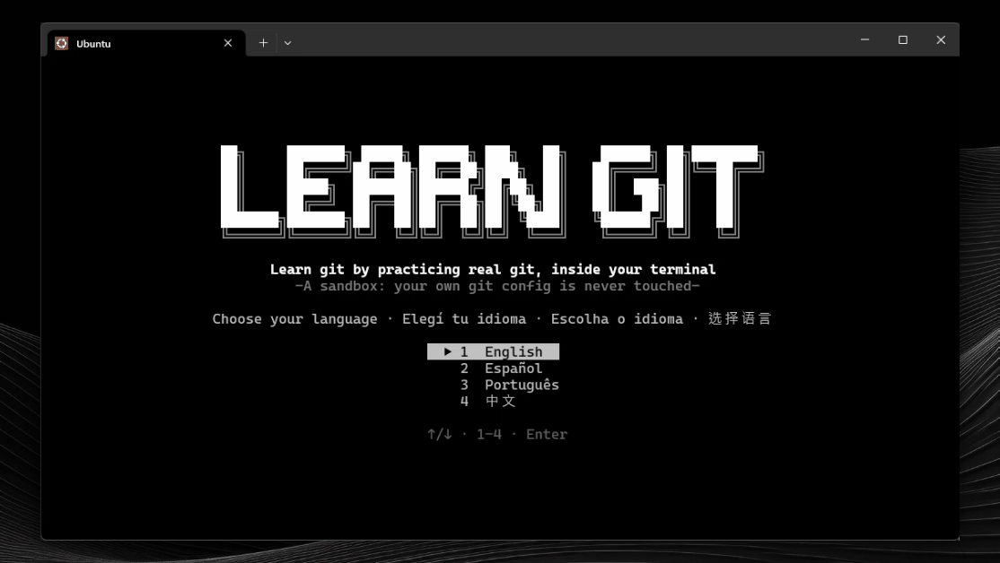
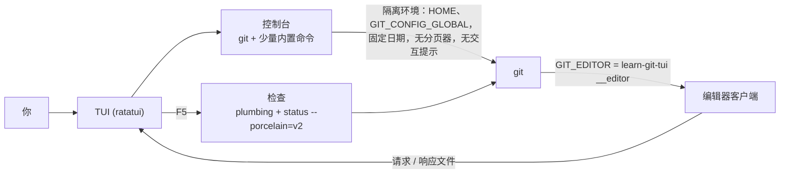

<div align="center">

[English](../../README.md) · [Español](README_es.md) · [Português (Brasil)](README_pt-BR.md) · **简体中文**

<!-- 横幅：截一张标题界面的图，保存为 docs/media/banner.png，然后把这段注释替换成：

-->

# learn-git-tui

### 在终端里用真实的 git 练习，学会 git。

**共 11 个级别、156 节课、153 个动手练习，支持英语、西班牙语、葡萄牙语和中文。每条命令都在隔离沙盒里的真实 git 上运行，绝不会碰你自己的配置。**

[](#安装)
[](#环境要求)
[](#环境要求)
[](#语言)

[演示](#演示) · [快速开始](#快速开始) · [工作原理](#工作原理) · [级别](#级别) · [按键](#按键) · [常见问题](#常见问题) · [开发](#开发)

</div>

> [!NOTE]
> 你练习用的是真正的 `git`，但你的环境是安全的：应用使用自己的 `HOME`、自己的全局配置和固定的日期。你的 `~/.gitconfig` 和凭据永远不会被读取或修改。

---

每个练习都会给你一个小场景（“一次提交搞坏了生产环境”“同事抢先推送了”）和一个控制台。你可以用任何方式解决；按下 `F5` 时检查的是**仓库的状态**，而不是你输入过哪些命令，所以任何正确的路径都算数。如果检查没通过，应用会说明缺了什么，并把沙盒恢复到练习开始时的样子。

## 演示

<!-- 演示 GIF：录制迷你课程，保存为 docs/media/demo.gif，然后把这段注释替换成：
<p align="center"></p>
-->

## 快速开始

### 环境要求

- **git 2.34 或更新版本**，并在 `PATH` 中。
- 可选项。缺少时，对应的课程会变成纯讲解：
  - `ssh-keygen`：用 SSH 签名的提交和标签。
  - `git subtree`：subtree 一课（有些发行版不自带）。
  - git 2.38 或更新版本：`git diagnose` 和 `git merge-tree --write-tree`。
- 从源码编译：Rust 稳定版，需支持 2024 edition（1.85 或更新）。

### 安装

从 [Releases](https://github.com/matiasdante/learn-git-in-a-tui/releases) 页面下载适合你系统的程序：

| 系统 | 文件 |
| --- | --- |
| Windows x86_64 | `learn-git-tui-windows-x86_64.exe` |
| Linux x86_64（静态链接） | `learn-git-tui-linux-x86_64` |

或者用 cargo 编译（macOS 上也用这种方式）：

```sh
cargo install --git https://github.com/matiasdante/learn-git-in-a-tui
```

### 运行

```sh
learn-git-tui
learn-git-tui --version
```

第一次启动时你要选择语言，还可以参加一个 10 道题的分级测试（第 1 到 5 级各 2 题）。全部答对从第 6 级开始；跳过则从第 1 级开始。之前的级别始终开放。

## 工作原理



- **控制台。** 运行 `git`，以及 `ls`、`cat`、`cd`、`pwd`、`mkdir`、`touch`、`rm`、`chmod +x`、`echo > / >>`、`edit` 和 `clear`，并为 git 支持 `<`、`>`、`>>` 重定向。整个过程不使用 shell，所以在 Windows 和 Linux 上的行为一致。`git -C`、`--git-dir` 和 `--work-tree` 只有指向沙盒内部时才会被接受。
- **编辑器。** 在执行不带 `-m` 的 `commit`、`rebase -i`、`mergetool`、`bugreport` 等命令时，git 会打开内置编辑器。这个编辑器就是同一个可执行文件加上隐藏的 `__editor` 子命令，通过沙盒里的文件与界面通信。
- **检查。** 使用底层命令和机器可读的格式（`rev-parse`、`for-each-ref`、`status --porcelain=v2`、`cat-file`）读取仓库，从不使用面向人类、且会随 git 版本变化的输出。
- **真实的 git。** 因为作者和提交者的日期是固定的，所以哈希值是稳定的。

## 级别

| # | 级别 | 课程 | 练习 |
| --- | --- | --- | --- |
| 1 | 基础 | 13 | 18 |
| 2 | 分支与标签 | 10 | 21 |
| 3 | 远程仓库（本地裸仓库，无需网络） | 7 | 14 |
| 4 | 撤销与重写 | 9 | 16 |
| 5 | 查看历史 | 10 | 10 |
| 6 | 补丁与邮件工作流 | 12 | 8 |
| 7 | 大型与多仓库 | 8 | 8 |
| 8 | 配置、安全与自动化 | 16 | 15 |
| 9 | 底层命令：对象与引用 | 35 | 25 |
| 10 | 存储与维护 | 18 | 18 |
| 11 | 服务器与协议（仅讲解） | 18 | 0 |

内部命令和服务器只做讲解、没有练习；已过时的命令不包含在内。`git maintenance start` 和 `register` 只讲解、从不运行，因为它们会改动你真实电脑上的任务计划程序。

## 语言

英语、西班牙语（`es`）、葡萄牙语（`pt`）和中文（`zh`）。在菜单里按 `L` 切换语言，选择会被保存。所有文本都在 `content/i18n/<语言>/` 里，只要任何语言缺少任何一段文本，测试就会失败。

## 按键

| 按键 | 作用 |
| --- | --- |
| `↑` `↓` · `Enter` · `Esc` | 移动、打开、返回 |
| `L` | 切换语言（菜单中） |
| `F1` | 显示下一条提示（−25 分） |
| `F5` | 检查练习（每次检查失败扣 10 分） |
| `F6` | 下一个练习 |
| `Ctrl+R` | 重新开始练习（自由模式下：重置沙盒） |
| `Ctrl+D` | 关闭正在运行的命令的 stdin（`credential approve`、`mktree` 等） |
| `Ctrl+C` | 停止正在运行的命令，或清空当前行 |
| `Ctrl+S` · `Esc` | 在编辑器中：保存并关闭 · 取消 |
| `Ctrl+Q` | 退出 |

每个练习 100 分，最低 25 分。另有独立沙盒的**自由模式**和 33 个**成就**。

## 数据存放位置

所有数据都在用户数据目录下的 `learn-git-tui` 文件夹里（Linux 是 `~/.local/share`，Windows 是 `%APPDATA%`）：

| 路径 | 内容 |
| --- | --- |
| `progress.json` | 语言、已完成的练习、分数和成就 |
| `sandbox/` | 练习用的仓库、它自己的 `HOME` 和自己的 `gitconfig` |

想从头开始，删除 `progress.json` 即可。

## 常见问题

<details>
<summary><strong>它会动我真实的 git 配置吗？</strong></summary>

不会。每个 git 进程都从空环境启动，只额外设置指向沙盒的 `HOME` 和 `GIT_CONFIG_GLOBAL`，以及 `GIT_CONFIG_NOSYSTEM=1`、`GIT_TERMINAL_PROMPT=0` 和固定日期。有一个测试会确认：在应用里执行 `git config --global` 不会改动你真实的 `~/.gitconfig`。

</details>

<details>
<summary><strong>我必须完全照课程建议的命令输入吗？</strong></summary>

不必。检查看的是仓库最终的状态，所以任何正确的方法都行。有些主题不会留下状态（`git help`、`git --version`），对这些主题，应用会查看你输入过什么。

</details>

<details>
<summary><strong>某一课显示“仅作讲解”，为什么？</strong></summary>

要么这个主题本来就没有练习（内部命令、服务器），要么你的机器缺少练习所需的东西：`ssh-keygen`、`git subtree` 或 git 2.38+。提示信息会写明缺了什么。

</details>

<details>
<summary><strong>需要联网吗？</strong></summary>

不需要。远程仓库是 `server.git` 这类文件夹里的裸仓库，沙盒里允许使用 `file://` 传输。

</details>

## 开发

```sh
cargo test
cargo clippy --all-targets -- -D warnings
cargo fmt --check
```

内容测试会遍历每一个练习：未做任何操作的初始状态必须通不过检查，参考答案则必须通过。它还要求每段文本在所有语言中都存在。CI 在 Ubuntu 和 Windows 上运行全部测试。

课程是 `content/level*/` 下的 TOML 文件，嵌入在可执行文件中。一个课程文件只包含结构（`setup` 动作、提示数量、声明式的 `checks`、一份参考 `solution`）；文本则放在 `content/i18n/{en,es,pt,zh}/` 里，键名形如 `init-1.prompt`、`init-1.hint1` 和 `init-1.check1.fail`。

## 发布

推送 `v*` 标签后，会编译 Windows 的 `.exe` 和静态链接的 Linux（musl）程序，并把两者发布到 Releases。

```sh
git tag -a v1.0.0 -m "v1.0.0"
git push origin v1.0.0
```

## 已知限制

- 不在范围内：通过网络的真实远程仓库、macOS 程序、鼠标支持、外部合并工具、自动更新和 ANSI 颜色。
- 较长的界面需要大约 100 列的终端。标题横幅至少需要 66 列（在级别地图上还需要较高的窗口），放不下时会退回为普通文字。
- 中文需要终端字体支持 CJK 字符。

## 许可证

[MIT](../../LICENSE)。任何人都可以免费使用、复制、修改和分发本项目，前提是保留版权声明：**© 2026 Matias Dante Sarco**，learn-git-tui 的创作者。
